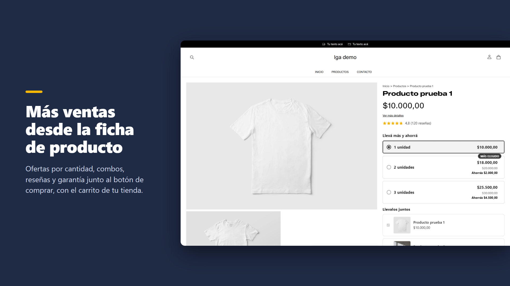
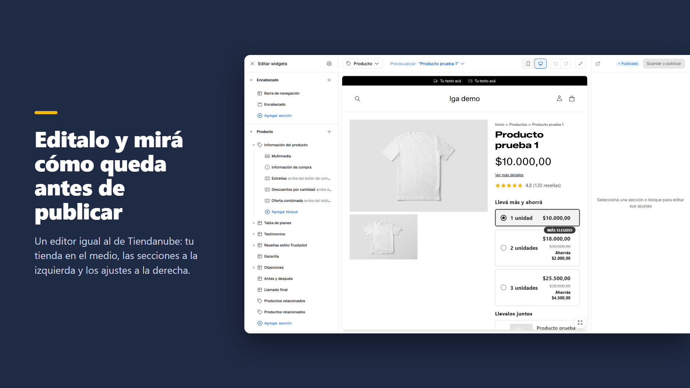

# Gadsden Widgets

Gadsden Widgets es una app gratis y open source (MIT) para Tiendanube que suma 80 secciones y bloques de venta a la
tienda, sobre todo a la ficha de producto: ofertas por cantidad, combos, productos para sumar, regalos, reseñas y
testimonios, garantía, preguntas frecuentes, tablas comparativas, popups y barra de compra fija.

Se arman en un editor igual a Editar diseño de Tiendanube, sin código y sin cambiar de theme, y andan en el plan gratis.
Los widgets se dibujan en la tienda con NubeSDK, el kit oficial de Tiendanube para apps.

Gratis para siempre: sin planes, sin prueba y sin costo de instalación.

- Instalar: https://www.tiendanube.com/apps/48010/authorize (está en revisión de Tiendanube)
- Soporte: admin@lga-arg.com

Lo que no hace: no pide ni modera reseñas (muestra las que carga el comerciante) y no cobra el descuento de una oferta
(lo cobra una promoción de la tienda; la app dice cuál crear).

Hecha por LGA, socio tecnológico de Tiendanube. No es un producto de Tiendanube.

Son 54 secciones y 26 bloques de la ficha de producto. Cada widget es el de
[Gadsden](https://github.com/peripequenho/gadsden-theme), con sus mismos estilos, animaciones e interacciones.



## Cómo se instala en una tienda

1. Entrá con tu cuenta de Tiendanube a <https://www.tiendanube.com/apps/48010/authorize> (en Nuvemshop:
   <https://www.nuvemshop.com.br/apps/48010/authorize>) y aceptá los permisos.
2. Abrí la app en **Mis aplicaciones › Gadsden Widgets**.
3. Elegí la página, agregá widgets con **+ Agregar sección** o **Agregar bloque**, editá textos, colores e imágenes y
   mirá cómo queda en computadora y en celular.
4. Tocá **Guardar y publicar**. Listo: lo ven tus compradores.

Los precios con descuento los cobra la tienda: el widget muestra la oferta, y para que el carrito la cobre hay que crear
la promoción en **Descuentos › Promociones**. El panel lo avisa.



## Cómo funciona por dentro

```
 Admin de Tiendanube              Worker de Cloudflare               La tienda
 (el comerciante)                 (worker.ts)                        (el comprador)
 ┌────────────────────┐  guarda   ┌──────────────────────────┐  lee  ┌──────────────────────────┐
 │ Panel / editor     │─────────▶ │ configuración (KV)       │◀─────▶│ Script de NubeSDK        │
 │ (src/panel/)       │           │ archivos de los widgets  │       │ (src/main.ts)            │
 └────────────────────┘           │ API de Tiendanube        │       │ un iframe por widget     │
                                  └──────────────────────────┘       │ (src/w/)                 │
                                                                     └──────────────────────────┘
```

1. **El panel** (`src/panel/`, React con Nimbus y Nexo) es el editor que ve el comerciante dentro del admin: árbol de
   secciones a la izquierda, su tienda real en el medio y los ajustes a la derecha. Al publicar, guarda la configuración
   de la tienda (un JSON) en el Worker.
2. **El Worker** (`worker.ts`) corre en Cloudflare, sin servidores propios: guarda la configuración de cada tienda y el
   permiso de su API en KV, sirve los archivos estáticos (`dist/`) y consulta productos y campos personalizados a la API
   de Tiendanube, con caché de 5 minutos.
3. **El script de la tienda** (`src/main.ts`) lo carga Tiendanube con NubeSDK en cada página. Pide la configuración,
   se fija qué página es y pone cada widget en su lugar (antes o después de una sección, en la columna de compra, fijo
   abajo).
4. **Cada widget** es un iframe (`src/w/`) donde corre el código original de Gadsden (Liquid, CSS y JavaScript, en
   `vendor/gadsden/`) con un motor de Liquid ([LiquidJS](https://liquidjs.com/)) y una base de estilos escrita de cero
   (`src/w/base.css`). Por eso se ve y se mueve igual que el original. Un error en un widget queda en su iframe.
5. **El carrito** es el de la tienda: cuando el comprador toca "Agregar al carrito", el script mira cómo cambió y suma
   lo que eligió en los widgets (más unidades, el adicional, el regalo).

Para verlos sin una tienda está el **arnés** (`arnes/`): una página que hace de NubeSDK y dibuja los widgets.

## Cómo correrlo

Hace falta Node.js 22.18 o más nuevo (corre TypeScript sin compilar).

```bash
npm ci
npm test
npm run tipos
npm run construir
```

- `npm run construir` arma `dist/`: el script de la tienda, la página de los widgets, el panel y su catálogo, el arnés
  y las páginas de privacidad y soporte. Recibe la URL pública del Worker como argumento
  (`node construir.mjs https://tu-worker.workers.dev`).
- `npx wrangler dev` levanta el Worker en tu máquina; abrí `/arnes/` para ver los widgets.
- Para publicar tu propia copia: una app propia en el portal de socios de Tiendanube, su id en `CLIENT_ID` de
  `wrangler.toml`, el secret con `npx wrangler secret put CLIENT_SECRET` (en local, en `.dev.vars`, que no se sube) y
  `npx wrangler deploy`.

## Estructura

- `worker.ts`: el Worker (instalación en `/callback`, webhooks obligatorios, `/api/*` del panel, `/config/*`,
  `/productos/*`, imágenes).
- `src/main.ts`, `src/gadsden.ts`, `src/lugares.ts`: el script de NubeSDK y dónde va cada widget.
- `src/vista.ts`: la vista previa del editor y el código para pegar.
- `src/w/`: la página del iframe, el motor de Liquid y las secciones propias (versiones configurables de las de Gadsden).
- `src/panel/`: el panel y el catálogo, en español y en portugués.
- `src/paginas/`: privacidad y soporte.
- `vendor/gadsden/`: los archivos de Gadsden que usan los widgets (ver [TERCEROS.md](TERCEROS.md)).
- `construir.mjs`: el armado de `dist/`.

## Cómo contribuir

Los issues y los pull requests son bienvenidos.

- Antes de mandar un cambio: `npm test`, `npm run tipos` y `npm run construir` tienen que pasar.
- Los widgets quedan tal cual el original de Gadsden: si algo se ve o se mueve distinto, es un error.
- Nada de código con licencias que no permitan redistribuirlo (por ejemplo, el de themes comerciales): la base de los
  widgets está escrita de cero por eso.
- Código, comentarios y textos en castellano.
- Nunca subas secretos (el client secret o tokens de tiendas).

Este repositorio se actualiza con fotos del repositorio de desarrollo (`herramientas/actualizar-publico.mjs`): cada
actualización llega como un commit nuevo.

## Licencia

MIT. Ver [LICENSE](LICENSE). Los archivos de terceros tienen la suya: ver [TERCEROS.md](TERCEROS.md).
